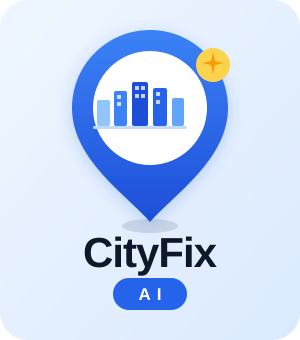

<div align="center">

<br/>



<h1>CityFix AI</h1>

<p><strong>Report once. Route smart. Fix faster.</strong></p>

<p>Built in 24 hours by <a href="https://github.com/adnannazirahmed">@adnannazirahmed</a> · <a href="https://github.com/mshirish">@mshirish</a> · <a href="https://github.com/Rjshrestha">@Rjshrestha</a></p>

<p>An AI-powered civic platform that turns resident photos into intelligent, prioritized work orders —<br/>so cities fix the <em>right</em> problems first.</p>

<p><strong>Live demo:</strong> <a href="https://YOUR-DEMO-URL.vercel.app">https://YOUR-DEMO-URL.vercel.app</a> <em>(sample data, simulated AI — see <a href="#whats-real-vs-simulated-in-the-demo">what's real vs simulated</a>)</em></p>

<br/>

[](https://nextjs.org)
[](https://www.typescriptlang.org)
[](https://tailwindcss.com)
[](https://supabase.com)
[](https://openai.com)
[](https://vercel.com)
[](LICENSE)

<br/>

</div>

---

## The Problem

Thousands of potholes go unfixed. Streetlights stay broken for months. Sidewalks crack and nobody acts.

Not because cities don't care — but because they lack **visibility**. Current reporting relies on phone hotlines and web forms that produce vague, unverified, unprioritized complaints. City staff spend their day doing manual triage instead of fixing things.

**CityFix AI eliminates that bottleneck.**

---

## What It Does

A resident snaps a photo, pins their location, and adds a brief description. In under **5 seconds**, GPT-4o Vision:

- Classifies the issue type and verifies the photo matches the description
- Scores **Urgency**, **Impact**, and **Priority** (each 0–100) using contextual factors
- Checks for duplicate reports in the same area
- Generates a formal civic report ready for city staff

City administrators open a dashboard and see exactly what needs to be fixed, why, and where — ranked by AI priority, not submission order.

---

## Key Features

### For Residents

| | Feature | Description |
|---|---|---|
| 📸 | **Photo Reporting** | Upload a photo, describe the issue, pin your location — done in 60 seconds |
| 💬 | **Multilingual AI Chat** | Report in English, Español, Português, or 5 other languages |
| 🗺️ | **Live Issue Map** | See every open report near you on an interactive map |
| 🏆 | **Gamification** | Earn accuracy & activity scores, compete on the public leaderboard |

### For City Administrators

| | Feature | Description |
|---|---|---|
| 🧠 | **AI Priority Scoring** | Every report scored on Urgency, Impact & Priority — not FIFO |
| 🔍 | **Duplicate Clustering** | Automatically groups nearby similar reports into a single cluster |
| ⚖️ | **Equity Heatmap** | Surfaces neighborhoods with disproportionately high unresolved issues |
| 📊 | **Analytics Dashboard** | Trends, category breakdowns, resolution rates, cluster narratives |
| 🤖 | **AI Situation Reports** | Auto-generated briefings for each cluster ready to send up the chain |

---

## Context-Aware Scoring

The AI doesn't just classify — it **reasons**.

> A broken streetlight outside an elementary school at 7 AM on a winter weekday → **Priority 93/100**  
> The same streetlight at noon in July → **Priority 58/100**

Factors the AI considers:

- Time of day, day of week, season
- Proximity to schools, hospitals, transit stops
- Estimated affected population radius
- Number of duplicate reports in the same cluster
- Neighborhood equity index

```
Priority = (Urgency × 0.60) + (Impact × 0.40)
         + Proximity Boost  (up to +30)
         + Cluster Boost    (up to +20)
         + Equity Boost     (up to +15)
```

**Priority tiers:**

| Score | Level |
|---|---|
| 85 – 100 | 🔴 Critical |
| 65 – 84 | 🟠 High |
| 40 – 64 | 🟡 Medium |
| 0 – 39 | 🟢 Low |

---

## Impact

| Metric | Result |
|---|---|
| ⚡ Classification speed | **95% faster** vs manual triage |
| 🔧 Reports resolved per week | **3× more** |
| ⚖️ Equity in underserved areas | **2.4× improvement** |
| 🤖 Average AI analysis time | **< 5 seconds** |

---

## Tech Stack

| Layer | Technology |
|---|---|
| **Framework** | Next.js 14 (App Router + Server Components) |
| **Language** | TypeScript |
| **Styling** | Tailwind CSS + shadcn/ui |
| **Database** | Supabase PostgreSQL |
| **Storage** | Supabase Storage |
| **AI** | OpenAI GPT-4o Vision |
| **Maps** | Leaflet + react-leaflet |
| **Charts** | Recharts |
| **Forms** | React Hook Form + Zod |
| **Auth** | Cookie-based admin sessions |
| **Deployment** | Vercel |

---

## Quick Start

### Zero-config demo (no API keys)

```bash
git clone https://github.com/adnannazirahmed/CityFixAI.git
cd CityFixAI
npm install
NEXT_PUBLIC_DEMO_MODE=true npm run dev
```

Open [http://localhost:3000](http://localhost:3000) — fully functional with **35 sample reports, 5 duplicate clusters, equity heatmap, and full analytics**.

Admin: click **Enter demo dashboard** on `/admin/login` (one-click login in demo mode), or sign in with:

```
Email:    admin@cityfix.ai
Password: cityfix-admin-2024
```

A banner at the top of every page links to a guided tour and a **Reset demo** button.

### Demo walkthrough

1. `/` — Landing page
2. `/report` — Submit a photo-based report, see AI scores live
3. `/chat` — Try multilingual AI chat reporting
4. `/map` — Explore all open issues on the map
5. `/leaderboard` — Community contributor scores
6. `/admin` — Full prioritized dashboard (one-click demo login)
7. `/admin/reports` — Filter, sort, update statuses
8. `/admin/analytics` — Equity heatmap, trend charts, cluster narratives

### What's real vs simulated in the demo

With `NEXT_PUBLIC_DEMO_MODE=true` the app runs with no database and no API keys.

| Area | In the demo |
|---|---|
| UI, routing, map, charts, leaderboard | **Real**: the same code as production |
| Priority scoring, duplicate/equity logic, badges, contributor scores | **Real**: same algorithms, run on demo data |
| Report data | **Sample**: 35 hand-written reports and 5 clusters for Worcester, MA ([`src/lib/demo-data.ts`](src/lib/demo-data.ts)) |
| Photo/description analysis (`/report`) | **Simulated**: keyword rules on the description; photos are not analyzed |
| Chat intake (`/chat`) | **Simulated**: scripted, rule-based replies. Full script in English, Spanish and Portuguese; other languages get a translated greeting, then English replies |
| Neighborhood insights and cluster narratives | **Simulated**: templated text |
| Your submissions, status changes and score | **Stored only in your browser** (`localStorage`). The server is read-only, so every visitor starts from the same sample data |
| Admin login | **Real signed session** (HMAC cookie), with a one-click demo login |

Demo mode never calls OpenAI, even if `OPENAI_API_KEY` is set.

---

## Full Setup

### 1. Configure environment

```bash
cp .env.example .env.local
```

```env
# Supabase
NEXT_PUBLIC_SUPABASE_URL=your_supabase_project_url
NEXT_PUBLIC_SUPABASE_ANON_KEY=your_supabase_anon_key
SUPABASE_SERVICE_ROLE_KEY=your_service_role_key

# OpenAI
OPENAI_API_KEY=sk-...

# Admin auth
ADMIN_EMAIL=admin@yourorg.com
ADMIN_PASSWORD=your_secure_password
ADMIN_SESSION_SECRET=long-random-string   # signs the admin session cookie (required outside demo mode)

# Demo mode — set false for production
NEXT_PUBLIC_DEMO_MODE=false
```

### 2. Database setup

Run in your Supabase SQL Editor:

```sql
-- Schema
\i supabase/migrations/001_initial.sql

-- Seed data (optional)
\i supabase/seed.sql
```

Create a **public** storage bucket named `report-images` in your Supabase dashboard.

### 3. Run

```bash
npm run dev      # development
npm run build    # production build
npm start        # production server
```

---

## Project Structure

```
CityFixAI/
├── src/
│   ├── middleware.ts                 # Guards /admin/* and report mutations (signed session)
│   ├── app/
│   │   ├── page.tsx                  # Landing page
│   │   ├── report/                   # Resident report flow (+ success page)
│   │   ├── chat/                     # Multilingual chat intake
│   │   ├── map/                      # Public issue map
│   │   ├── leaderboard/              # Community leaderboard
│   │   ├── admin/                    # Login, dashboard, reports, analytics
│   │   └── api/
│   │       ├── reports/              # List/create reports; [id] get/update/delete
│   │       ├── ai/analyze/           # GPT-4o Vision report analysis
│   │       ├── ai/cluster-narrative/ # AI narratives for duplicate clusters
│   │       ├── ai/neighborhood-insight/  # AI neighborhood situation report
│   │       ├── chat/                 # Chat intake turn handler
│   │       ├── clusters/             # Duplicate clusters
│   │       ├── insights/             # Dashboard stats + equity insights
│   │       ├── leaderboard/          # Top contributors
│   │       ├── users/[id]/           # Contributor score
│   │       ├── upload/               # Image upload (Supabase Storage)
│   │       └── admin/login/          # Admin login / logout / session check
│   ├── components/
│   │   ├── dashboard/                # Stats cards, charts, heatmap, AI panels
│   │   ├── forms/                    # Report submission form
│   │   ├── map/                      # Leaflet map
│   │   ├── chat/                     # Intake chat UI
│   │   ├── layout/                   # Navbar, admin sidebar, demo banner
│   │   ├── shared/                   # Priority/status badges, AI and score cards
│   │   └── ui/                       # shadcn/ui primitives
│   ├── data/
│   │   └── seeclickfix-categories.ts # Categories, departments, SLAs, keywords
│   └── lib/
│       ├── openai/analyze.ts         # GPT-4o Vision analysis (+ rule-based fallback)
│       ├── openai/intake-chat.ts     # Chat intake (+ scripted fallback)
│       ├── scoring/priority.ts       # Priority scoring, duplicates, equity
│       ├── scoring/user-score.ts     # Contributor scores and badges (client-safe)
│       ├── auth/session.ts           # HMAC-signed admin session tokens
│       ├── demo/config.ts            # IS_DEMO, aiEnabled(), demo admin credentials
│       ├── demo/browser-store.ts     # Demo: per-visitor localStorage overlay (apiFetch)
│       ├── visitor-id.ts             # Anonymous contributor id (cityfix_user_id)
│       ├── demo-data.ts              # Sample dataset (35 reports, 5 clusters)
│       ├── store.ts, user-store.ts   # In-memory stores (seed data)
│       └── supabase/                 # DB clients
└── supabase/
    ├── migrations/001_initial.sql    # Schema
    └── seed.sql                      # Seed data
```

---

## AI Pipeline

```
Resident submits photo + location + description
              │
              ▼
    GPT-4o Vision analyzes
    ├── Classify issue type
    ├── Verify photo matches description
    ├── Score base severity
    └── Generate formal report draft
              │
              ▼
    Context engine applies boosters
    ├── Time of day + season
    ├── Proximity (schools, hospitals, transit)
    ├── Cluster size (duplicate count)
    └── Neighborhood equity index
              │
              ▼
    Final scores written to DB
    ├── Urgency  0–100
    ├── Impact   0–100
    └── Priority 0–100
              │
              ▼
    Admin dashboard surfaces critical issues first
```

---

## Deployment

**Vercel: public demo (free tier, no keys)**

1. Import the repo at [vercel.com/new](https://vercel.com/new) (framework preset: Next.js).
2. Under **Settings → Environment Variables**, add `NEXT_PUBLIC_DEMO_MODE=true`.
   Optionally add `ADMIN_SESSION_SECRET` (any long random string) to replace the built-in demo fallback.
   Leave `OPENAI_API_KEY` and the Supabase variables unset; demo mode doesn't use them.
3. Deploy. `NEXT_PUBLIC_*` variables are inlined at build time, so redeploy after changing them.

**Vercel: production**

Set all `.env.local` variables (Supabase, OpenAI, `ADMIN_EMAIL`, `ADMIN_PASSWORD`, `ADMIN_SESSION_SECRET`) with `NEXT_PUBLIC_DEMO_MODE=false`, then:

```bash
vercel deploy --prod
```

Without `ADMIN_SESSION_SECRET`, admin login is disabled outside demo mode.

**Self-hosted**

```bash
npm run build && npm start
```

Standard Next.js — works on any Node.js host.

---

## Built at a Hackathon

CityFix AI was built in a single sprint to prove that a small team with the right AI tools can ship something cities actually need. No enterprise budget. No GIS team. Just Next.js, Supabase, and GPT-4o Vision.

**What we shipped:**
- Full resident reporting flow with AI analysis
- Admin dashboard with priority scoring, clustering, and equity heatmap
- Multilingual AI chat intake (8 languages)
- Gamified leaderboard
- Demo mode that works out of the box with zero configuration

---

<div align="center">

**MIT License · Built with GPT-4o · Next.js · Supabase**

*"The best cities aren't built with the most resources — they're built with the smartest decisions."*

</div>
